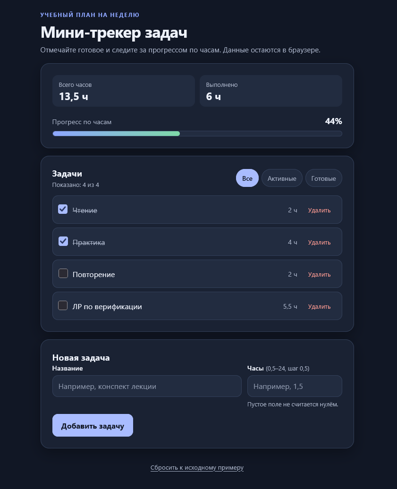
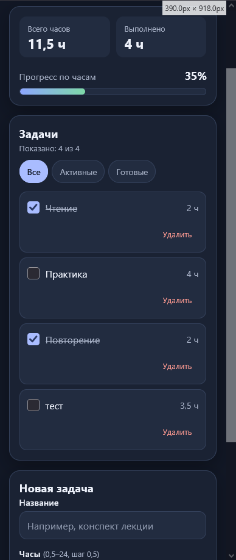
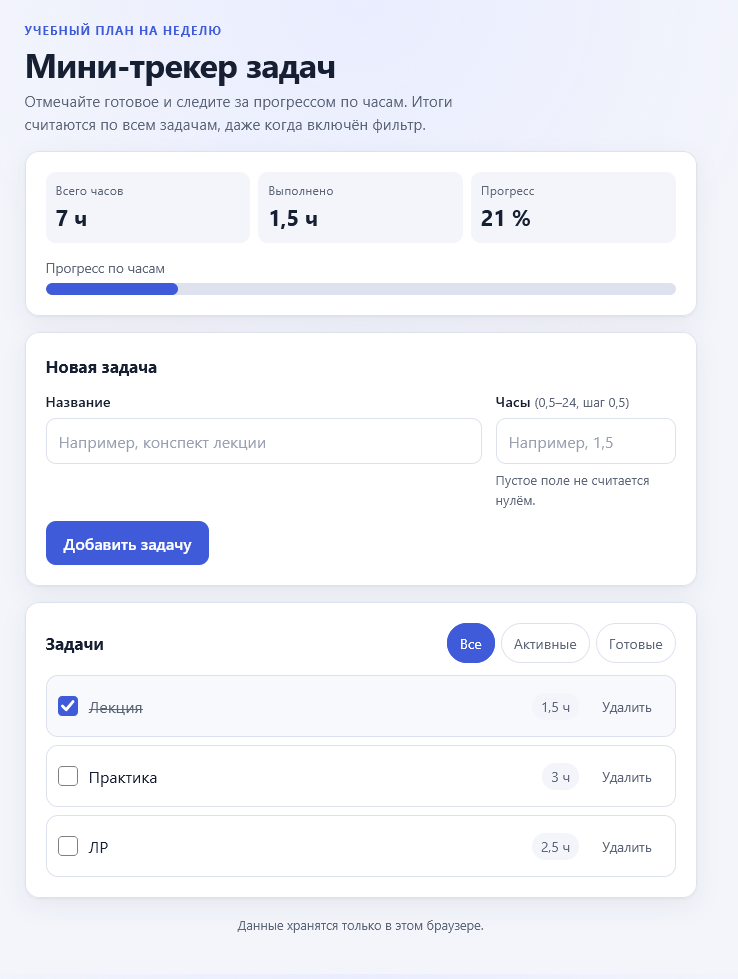
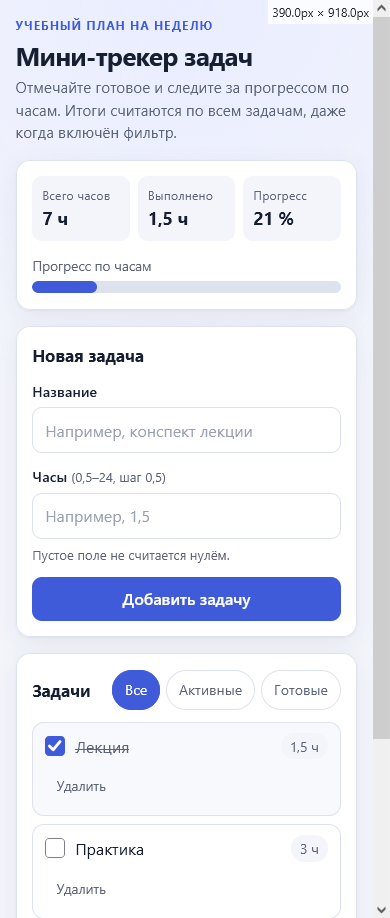

# Домашнее задание 1
Мини-трекер учебных задач, вариант B (Средний)
Сравнение двух способов разработки автономного мини-трекера учебных задач: прямой и со спецификацией OpenSpec

## Запуск
Для запуска приложения нужен HTTP-сервер. Для этого в папке "direct" или "with-spec" нужно выполнить (должен быть доступен Node.js):
```
npx --yes http-server@14.1.1 . -p 8080 -c-1
```

Для запуска автотестов нужно выполнить:
```
node --test tests/acceptance.test.mjs
node --check app.mjs
node --check domain.mjs
```

Для проверки спецификации with-spec также нужно выполнить:
```
npm install -g @fission-ai/openspec@1.14.1
openspec validate build-tracker --strict --no-interactive
```

## Сравнение двух результатов
Модель: DeepSeek v4.1 Flash Free внутри OpenCode
Дата выполнения: 14.11.2026

| Критерий | Direct | With-spec |
|---|---:|---:|
| Время | 3:30 | 7:10 |
| Токены | 41600 | 104000 |
| Кэширование токенов | 88% (36700) | 99% (103200) |
| Обращения к модели | 2 | 4 |
|Автотесты | 6/6 | 38/38
| Тесты T1–T5 | PASS | PASS |
| Адаптивный дизайн | + | + |
| Кнопка сброса к исходному<br> примеру (в задании <br> была опциональной) | Есть | Нет |
| Автоматический выбор темы<br> интерфейса (в задании не<br> заявлялся, но приятно) | Есть | Нет |

Также хочу отметить, что в задании "direct" агент предложил запустить сервер командой ` python -m http.server 8000`, в которой не подгружались .mjs-файлы, из-за чего приложение было статичным. Но при указании на это агент сам разобрался, в чём причина, и предложил рабочую команду:
```
python -c "import http.server, socketserver; H = type('H', (http.server.SimpleHTTPRequestHandler,), {'extensions_map': dict(http.server.SimpleHTTPRequestHandler.extensions_map, **{'.mjs': 'text/javascript'})}); socketserver.TCPServer(('127.0.0.1', 8000), H).serve_forever()"
```

А в задании "with-spec" в ходе ручной проверки я обнаружил баг, что в первоначальной реализации не принимаются числа с разделителем ',' (например 3,5). В варианте "direct" сразу принимались оба варианта

## Скриншоты

| direct (Desktop) | direct (Mobile 390px) |
| :---: | :---: |
|  |  |

| with-spec (Desktop) | with-spec (Mobile 390px) |
| :---: | :---: |
|  |  |
